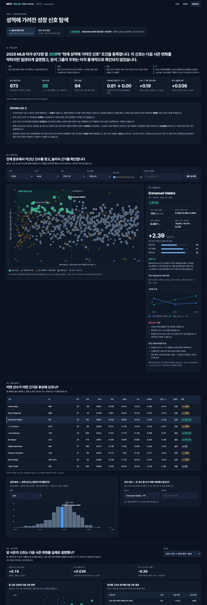

# NEXT VALUE — Hitter Radar

*Find the signals others overlook.*

**v0.1.0** · MLB 2023–2025 · KBO 2024–2025 Local · Batters Only · Experimental

> Experimental MLB hitter scouting dashboard using 2023–2025 batting data, with optional KBO analysis. v0.1.0

### **[▶ 서비스 바로 보기](https://justman-yzz.github.io/next-value-hitter-radar/)** · **[대시보드](https://justman-yzz.github.io/next-value-hitter-radar/dashboard.html)** · **[산점도](https://justman-yzz.github.io/next-value-hitter-radar/graph.html)**

설치나 파일 업로드 없이, 실제 MLB 2023–2025 정규시즌 타자 기록으로 바로 작동합니다.

---

## 1. 프로젝트 소개

OPS 같은 결과 지표는 이미 잘하는 선수를 보여 줍니다. Hitter Radar는 반대로 **같은 OPS 수준에서 기대되는 것보다 장타(ISO)·선구(BB%)·컨택(K%) 지표가 앞선 타자**를 전체 선수에서 찾습니다.

- 같은 리그·같은 시즌 안에서만 비교합니다.
- 결과는 "확정 후보"가 아니라 **먼저 살펴볼 선수 목록**입니다.
- 신호가 다음 시즌 변화를 얼마나 설명하는지는 **탐색적 백테스트**로 확인합니다.
- 특정 미래 시즌의 성적을 예측하거나 성공 확률을 계산하는 모델이 아닙니다.

**지금 바로 할 수 있는 것**

- 시즌별 MLB 타자 전원을 산점도에서 탐색하고 선수를 눌러 근거와 위험을 확인
- 검색·구단·최소 타석·선수 상태로 거르기, 두 선수 비교
- 백테스트 결과 확인
- (선택) 이용 권한이 있는 KBO CSV를 브라우저 안에서만 분석

<p align="center">
  <a href="docs/screenshots/dashboard.png"></a><br>
  <sub>대시보드 전체 화면(MLB 2025, 데스크톱 1440px). 이미지를 누르면 원본 크기로 볼 수 있습니다. 모바일 화면은 <a href="docs/screenshots/">docs/screenshots/</a>에 있습니다.</sub>
</p>

| 페이지 | 내용 |
|---|---|
| [소개](https://justman-yzz.github.io/next-value-hitter-radar/) (`index.html`) | 프로젝트 소개, 실제 MLB 데이터로 계산한 핵심 결과, 두 모드 안내 |
| [산점도](https://justman-yzz.github.io/next-value-hitter-radar/graph.html) (`graph.html`) | 산점도 한 장으로 보는 전체 타자 분포와 선택 선수 지표 |
| [대시보드](https://justman-yzz.github.io/next-value-hitter-radar/dashboard.html) (`dashboard.html`) | 핵심 발견, 탐색 지도, 후보 탐색기, 신호 검증(백테스트), 방법론·데이터 상태 |

이 프로젝트는 개발 기간에 "NEXT VALUE 2027"이라는 이름을 썼고, 공개 전에 지금 이름으로 바꿨습니다(이유는 [CHANGELOG](CHANGELOG.md)에 있습니다).

## 2. 현재 버전과 데이터 범위 (v0.1.0)

### 구현 완료

| 모드 | 범위 | 공개 여부 |
|---|---|---|
| **MLB 공개 분석** (기본) | 2023–2025 **정규시즌**, **타자 전용**, 1타석 이상 **1,980개 선수-시즌**(656 / 651 / 673) | 공개. 사이트에 내장되어 파일 없이 바로 작동 |
| **KBO 로컬 분석** | 2024–2025시즌 1군 타자 기록을 **사용자가 CSV로 업로드** | 비공개. 사이트와 저장소에 KBO 선수 기록이 없고, 파일은 브라우저 안에서만 처리됨 |

- **KBO를 공개하지 않는 이유:** 개발자가 로컬에서 검증한 KBO 데이터(2024 293명, 2025 295명)는 원 출처의 재배포 권리가 확인되지 않았습니다. 또 KBO 홈페이지 약관(2026.10.14 시행)은 자동 수집과 재배포·2차 가공을 제한합니다.
- **KBO 데이터 누락:** 로컬 원본은 공식 팀 합계보다 2024년 143타석, 2025년 26타석이 적습니다.
- **두 리그를 섞지 않음:** MLB와 KBO는 백분위·회귀계수·백테스트를 따로 계산합니다.

### 현재 미지원

- 2026년 MLB·KBO 기록(공개 이용이 허가된 원본이 아직 없음)
- 퓨처스리그·마이너리그 전수 분석
- 투수 분석
- 검증된 미래 활약 확률, 연봉·가치 예측

## 3. 주요 기능

- **탐색 지도(산점도):**
  - 가로는 OPS 백분위, 세로는 독립 신호 z입니다. 해당 시즌 30타석 이상 타자 전원을 표시합니다.
  - 가장 가까운 점 선택, 터치·키보드 조작, 검색한 선수만 강조하는 기능이 있습니다.
- **필터:** 시즌·리그·구단·선수 상태·최소 타석·검색, 필터 초기화. 지도·표·분포·비교에 함께 적용됩니다.
- **선수 인텔리전스:** 기본 기록, 세부 지표 백분위, 성장 근거, 반대 근거·위험, 표본 참고 지수(4절 참고), 직전 시즌 대비 변화, 시즌별 추세, 다음 시즌에 확인할 지표
- **후보 탐색기:** 정렬 가능한 선수 표, 성적 분포 히스토그램, 두 선수 비교
- **신호 검증:** 연속된 두 시즌으로 탐색적 백테스트를 실행합니다. 기준 모형 대비 추가 설명력, 후보 선정 방식별 비교, 순열검정을 함께 봅니다.
- **KBO CSV 업로드:** 브라우저 안에서만 처리하며, league가 KBO/FUTURES가 아닌 행은 거부합니다.
- **과제 1 단독 실행 HTML:** `submission/graph_standalone.html`

## 4. 분석 지표와 방법론

- **비교 집단:** 같은 리그·같은 시즌의 30타석 이상 타자
- **v1 세부능력 점수** = ISO 백분위×0.45 + BB% 백분위×0.30 + (100 − K% 백분위)×0.25
  - 가중치는 가설 값이며 데이터로 추정하지 않았습니다.
  - v1은 OPS 백분위와 상관이 0.79–0.83으로 높아, 현재 성적을 다시 재는 것에 가깝습니다.
- **v2 독립 신호 z:** v1을 OPS 백분위에 선형회귀한 잔차를 표준화한 값입니다.
  - OPS와의 상관이 0인 것은 **회귀 잔차의 수학적 성질**일 뿐, 예측력의 증거가 아닙니다.
- **원석 신호:** z ≥ 1.0, OPS 백분위 < 45, 100타석 이상
  - KBO 탐색 단계에서 정했고, MLB 데이터를 본 뒤 바꾸지 않았습니다.
- **표본 참고 지수:** 소표본 선수를 지우지 않고, 표본 크기를 함께 보도록 붙인 **프로젝트 내부의 근사 지표**입니다. 화면에도 같은 이름으로 표시합니다.
  - **계산:** 지표별 `PA / (PA + M)`의 평균입니다. M은 K% 60, BB% 120, ISO 160입니다.
  - **구간:** 0.7 이상 "높음", 0.5 이상 "보통", 그 미만 "낮음"입니다. 이 구간은 **프로젝트에서 임의로 정한 분류 기준**입니다.
  - **M의 출처:** M 값은 [FanGraphs Sample Size](https://library.fangraphs.com/principles/sample-size/)에 정리된 안정화 기준(K% 60 PA, BB% 120 PA, ISO 160 AB)을 빌려 왔습니다.
  - **FanGraphs 기준과 다른 점:**
    1. **정의가 다릅니다.** FanGraphs의 안정화 지점은 표본 간 상관이 약 0.7에 이르는 지점입니다. 이 프로젝트의 식에서는 PA = M일 때 값이 0.5입니다. 따라서 이 지수는 FanGraphs가 측정한 신뢰도와 같은 척도가 아닙니다.
    2. **단위가 다릅니다.** ISO 기준은 원래 AB 단위인데, 이 코드는 세 지표 모두 PA로 계산합니다.
    3. **검증하지 않았습니다.** 이 데이터로 따로 추정하거나 검증하지 않았습니다.
  - 그러므로 이 값은 **외부 연구에서 검증된 신뢰도가 아니고, 실제 성공 확률도 아닙니다.** 표본이 작을수록 수치를 덜 믿으라는 **상대적 참고값**으로만 읽어 주세요.
- **MLB 가공 규칙:**
  - 시즌 중 구단 이동은 1행으로 합산했습니다.
  - PA = AB+BB+HBP+SH+SF입니다. 포수 타격방해(CI)가 빠져 있어 공식 PA보다 0~3 적을 수 있습니다.
  - 나이는 6월 30일 기준이고, 주 포지션은 수비 경기 수로 정했습니다.
- **MLB 데이터 검수:**
  - 선수 합계가 구단 합계와 7개 지표에서 정확히 일치했습니다.
  - 선수 5명, 10개 선수-시즌을 공식 기록과 대조했고, PA 외 지표가 모두 일치했습니다(PA 차이 = CI 수).

## 5. 탐색적 백테스트 결과와 한계

앞 시즌 기록만으로 신호를 만들고, 다음 시즌 OPS 백분위 변화와 비교했습니다. 대상은 두 시즌 모두 100타석 이상인 선수이고, 순열검정은 고정 시드로 5,000회 반복했습니다.

| 지표 | MLB 2023→2024 | MLB 2024→2025 | KBO 2024→2025 (로컬) |
|---|---|---|---|
| 대상 | 358명 | 362명 | 106명 |
| r(v2 신호, 변화) | +0.25 (p < 0.001) | +0.19 (p < 0.001) | +0.24 (p = 0.007) |
| OPS 백분위·나이 기준 모형 대비 ΔR² | +0.050 | +0.036 | +0.036 (p = 0.037) |
| 원석 그룹 − 나머지 OPS 하위 선수 | +8.9 (p = 0.145) | +7.9 (p = 0.117) | +13.1 (p = 0.113) |

- **해석(탐색적 결과):** 이 데이터 안에서, v2 신호는 현재 OPS와 나이로 설명되지 않는 다음 시즌 변화의 일부를 작게 설명했습니다(ΔR² +0.036~+0.050). 확인한 세 개의 시즌 쌍 모두 방향이 같았습니다.
  - 다만 **독립 표본(모델을 설계할 때 보지 않은 데이터, 예: 2026 시즌)에서는 아직 검증하지 않았습니다.**
  - 따라서 이 결과를 신호의 예측력이 확인되었다는 근거로 읽으면 안 됩니다.
  - p값은 같은 데이터에서 계산한 순열검정 값이며, 여러 비교를 했다는 점은 보정하지 않았습니다.
- **원석 그룹:** 나머지 선수보다 평균적으로 더 올랐지만, 그 차이는 **세 경우 모두 통계적으로 유의하지 않습니다.**
- **한계:**
  - 비교한 시즌 쌍이 적습니다.
  - 두 시즌 모두 100타석 이상인 선수만 포함해 생존 편향이 있습니다.
  - 구장·부상·수비 위치는 보정하지 않았습니다.
  - 같은 사람이 설계했으므로 **독립 검증이 아니라 탐색적 검증**입니다.
  - 2025→2026 표본 외 검증은 2026 데이터가 없어 하지 못했습니다.

자세한 내용은 `DATA_AUDIT.md` 7·9절에 있습니다.

## 6. 데이터 출처와 라이선스

| 대상 | 출처 · 조건 |
|---|---|
| **MLB 데이터** (`data/public/`) | [SABR Lahman Baseball Database](https://sabr.org/lahman-database/) 1871–2025(2025판). Copyright 1996–2025 SABR(Sean Lahman 기증). **[CC BY-SA 3.0](https://creativecommons.org/licenses/by-sa/3.0/)**. 이 저장소의 가공 데이터(`mlb_lahman_2023_2025.csv/.js`)도 **같은 CC BY-SA 3.0**을 따르며, 출처 표기와 동일조건 의무가 적용됩니다. 가공 내역은 `data/public/README.md`에 있습니다. |
| **KBO 데이터** | 공개하지 않습니다. 사용자가 이용 권한이 있는 파일을 직접 불러와야 합니다. |
| **글꼴** | [Pretendard](https://github.com/orioncactus/pretendard) v1.3.9, SIL Open Font License. CDN으로 불러옵니다. |
| **자체 작성 코드** (HTML·CSS·JS·PowerShell) | **위 데이터 라이선스와 별개입니다.** 저장소 소유자가 코드 라이선스를 아직 지정하지 않았습니다. 지정 전까지는 기본 저작권(All rights reserved)이 적용됩니다. |

MLB, SABR, KBO는 이 프로젝트와 관련이 없으며, 이 프로젝트를 보증하지 않습니다.

## 7. 실행 방법과 GitHub Pages

- **바로 보기:** [공개 사이트](https://justman-yzz.github.io/next-value-hitter-radar/)에 접속하면 MLB 데이터로 즉시 작동합니다. 빌드나 서버가 필요 없는 정적 사이트입니다.
- **로컬 실행:** 다음을 실행한 뒤 http://localhost:8765 에 접속합니다. Windows PowerShell만 있으면 되고 Python·Node는 필요 없습니다.
  ```
  powershell -ExecutionPolicy Bypass -File scripts\serve.ps1
  ```
  HTML을 브라우저로 직접 열어도 작동합니다.
- **KBO 분석:** 대시보드에서 **KBO 원석 발굴**을 선택하고 CSV를 불러옵니다.
  - 필수 열: `season, league, player_name, team, PA, BB, SO` (league = `KBO` 또는 `FUTURES`)
  - 점수 계산에 필요: `OBP`(또는 `H, AB, HBP, SF`)와 `AVG·SLG`(또는 `AB, H, 2B, 3B, HR`)
  - 권장 열: `player_id, age`
  - 헤더 예시: `data/schema.csv`
- **MLB 데이터 재생성:** Lahman 2025판 CSV를 `data/sources/lahman_2025/`에 둔 뒤 다음을 실행합니다.
  ```
  powershell -ExecutionPolicy Bypass -File scripts\build_mlb.ps1
  ```
- **GitHub Pages:** <https://justman-yzz.github.io/next-value-hitter-radar/>
  - 이 저장소의 최상위에 사이트 파일이 있으며, 모든 경로는 상대경로입니다.
  - Settings → Pages에서 `main` 브랜치의 `/ (root)`를 지정합니다.
  - `.nojekyll`이 있어 파일이 그대로 제공됩니다.

## 8. 프로젝트 구조

```
index.html · graph.html · dashboard.html   사이트 페이지
assets/theme.css                            디자인 토큰·공통 컴포넌트
assets/scatter.js                           공용 산점도(근접 선택·터치·키보드)
assets/model.js                             정규화·v1/v2 점수·표본 참고 지수·백테스트 (데이터 없음)
data/public/                                MLB 공개 데이터(CC BY-SA 3.0)와 가공 내역
data/schema.csv                             KBO CSV 헤더 예시(헤더만)
submission/graph_standalone.html            과제 1 단독 실행본
docs/screenshots/                           데스크톱·모바일 화면
scripts/                                    MLB 가공, 단독본·배포 폴더 빌드, 공개 점검, 로컬 서버
README.md · CHANGELOG.md                    소개·버전 기록
DATA_AUDIT.md · DATA_VERIFICATION.md        데이터 검수·출처 실사
DESIGN_DECISIONS.md · DESIGN_QA.md          디자인 결정·검수
```

KBO 원본·정규화 데이터, 선수별 검수 자료, 회귀 테스트 기준값은 개발자 로컬에만 있으며 저장소에 포함하지 않았습니다.

## 9. 향후 개발 로드맵

| 버전 | 상태 | 내용 |
|---|---|---|
| **v0.1.0** | ✅ 구현 완료 (현재) | MLB 2023–2025 타자 분석, KBO 2024–2025 로컬 CSV 모드, 탐색적 백테스트 2회(MLB), 반응형 다크 UI |
| v0.2.0 | 계획 | 추가 시즌 데이터(공개 이용이 허가된 2026 원본 확보 시)와 표본 외 검증 확대 |
| v0.3.0 | 검토 | 퓨처스·마이너리그 분석(허가된 데이터 확보와 리그 난이도 보정 방법 검토) |
| v0.4.0 | 검토 | 투수 분석 |
| v1.0.0 | 목표 | 독립 검증을 거친 통합 스카우팅 서비스 |

계획·검토 단계의 항목은 **아직 구현되지 않았으며**, 일정과 범위는 바뀔 수 있습니다. 변경 내역은 `CHANGELOG.md`에 있습니다.

## 10. 학습 및 제작 목적

나노디그리 AI Agent 학습을 위해 Claude Code와 함께 만든 교육용 프로젝트입니다. 화려한 결과보다 다음 과정을 보여 주는 데 목적이 있습니다.

- 데이터 권리 확인
- 공식 기록과의 대조 검수
- 기대와 다른 결과(유의하지 않은 그룹 차이)를 숨기지 않는 보고
- 회귀 테스트로 디자인 변경 전후 결과를 지키는 과정

상업적 스카우팅 판단의 근거로 쓰기 위한 서비스가 아닙니다.
